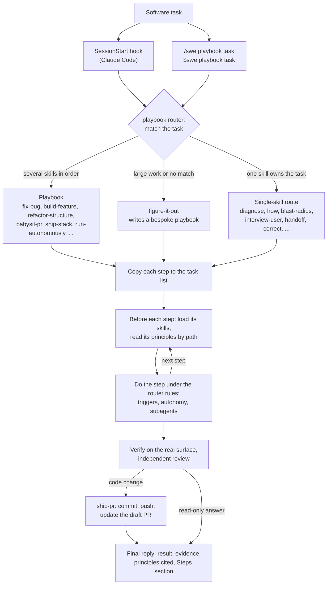

# agent-toolbox

Plugins of skills for AI coding agents, for Claude Code and Codex CLI. Install
the plugins you need; each one works alone.

## Install

Claude Code:

```text
/plugin marketplace add kpeez/agent-toolbox
/plugin install swe@agent-toolbox
/plugin install lab@agent-toolbox
/plugin install uni@agent-toolbox
```

Codex CLI:

```text
codex plugin marketplace add kpeez/agent-toolbox
codex plugin add swe@agent-toolbox
codex plugin add lab@agent-toolbox
codex plugin add uni@agent-toolbox
```

Start a new session after you install. To install the skills only, without
plugin agents, hooks, or the swe router, run
`npx skills@latest add kpeez/agent-toolbox`.

## Quick start

Give the swe router a task:

```text
/swe:playbook fix the login redirect loop
```

In Codex, type `$swe:playbook <task>`. The router picks a playbook, such as
`fix-bug`, runs its steps, and ends with the state of each step.

## How swe works



The router holds 22 playbooks, 25 principles, and the rules every step
follows. Each step names the skills and principles it needs, and the router
loads them at that step only. See [docs/swe.md](docs/swe.md) for the
playbooks, skills, and principles.

## What is included

| Part | What it does | Docs |
| --- | --- | --- |
| `swe` plugin | A task router with playbooks, and skills to plan, build, test, review, and ship code | [docs/swe.md](docs/swe.md) |
| `lab` plugin | Cited research memos and reports, experiment loops, and plot guidance | [docs/lab.md](docs/lab.md) |
| `uni` plugin | Interactive lessons with questions, recall, and exercises | [plugins/uni/README.md](plugins/uni/README.md) |
| Claude Code mods | Live panes for tool calls, subagents, and the session | [docs/mods.md](docs/mods.md) |

## Docs

- [swe](docs/swe.md): the router, the skills, delegation, and project files.
- [Handoffs](docs/handoffs.md): continue work in a new session or on a new host.
- [lab](docs/lab.md): research and experiment skills.
- [Mods](docs/mods.md): Claude Code panes.
- [Contributing](docs/contributing.md): layout, versions, and release checks.

## Credits

- The `swe` router, its playbooks and principles, and most `swe` skills adapt
  Lauren Tan's [pstack](https://github.com/cursor/plugins/tree/1e5c90a4b6f249917bd21fe361b3a2a7deb741b8/pstack).
- Many `swe` skills, and `uni/skills/teach`, adapt Matt Pocock's
  [skills](https://github.com/mattpocock/skills).
- The `ship-pr` PR-body menu of visuals comes from Dex Horthy's
  [`show-me` skill](https://github.com/humanlayer/skills/blob/main/plugins/show-me/skills/show-me/SKILL.md).
- The audit mode of `swe/skills/testing-code` adapts the OpenClaw
  [test-audit skill](https://github.com/openclaw/openclaw/tree/80930af448ebabc84174146b56bc106d37fab3b4/.agents/skills/test-audit).

Each adapted skill folder has a `NOTICE` with its source and license.
