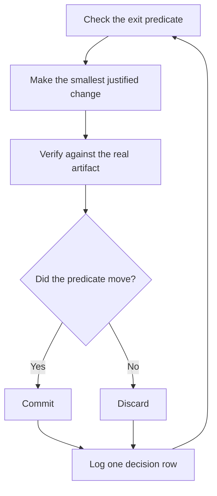
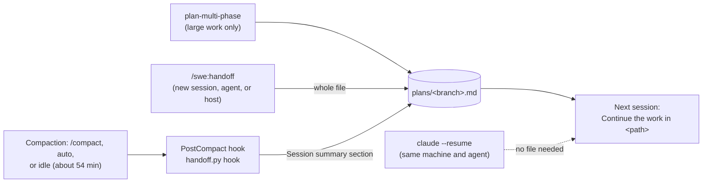

# Run long work and hand it off

This page shows you how to leave an agent on a long task, audit what it decided, and move work between sessions, agents, and hosts. It also covers queues of PRs, multi-day programs, delegation, and where swe keeps its files. A run you can leave alone needs a checkable finish condition, an isolated worktree, and a decision log you can read when you come back.

## Drive one task to an exit condition

Give the run a goal, a predicate that can pass or fail, permissions, and a way out:

```text
/swe:swe-mode going to bed. migrate every caller to the new parser in a fresh worktree off <base>.
done means zero old callers, all parser fixtures pass, and the old api is deleted.
keep a decision log. commit without asking me.
if you are truly stuck after a few hours, stop and write up why.
```

"Going to bed" is a session override. The agent stops asking and decides each call itself, then reports it. The [`run-autonomously`](../../plugins/swe/skills/swe-mode/playbooks/run-autonomously.md) playbook states the exit predicate first. In Claude Code it wakes itself with `/loop`, or with a background watcher such as `gh pr checks <pr> --watch` when there is an event to watch. In Codex you rerun the task by hand. Each iteration follows the same loop:



A plateau means pivot, not stop. The agent never relaxes the predicate to declare victory. A duration is not a predicate. "Work on this for 4 hours" gives the agent nothing to check.

Large or cross-cutting work, and work you step away from, goes to [`figure-it-out`](../../plugins/swe/skills/figure-it-out/SKILL.md) when no playbook fits. It designs the run's phases before any code and keeps the decision log.

## Keep a decision log

For a long, multi-phase, or unattended run, the [`log-decisions`](../../plugins/swe/skills/log-decisions/SKILL.md) skill keeps an append-only log next to the handoff file: `<branch>.decisions.jsonl`. Each line is one decision with `ts`, `phase`, `decision`, `why`, `evidence` (a list of pointers), and `result`. Append a row:

```bash
python3 plugins/swe/scripts/handoff.py log --phase frame \
  --decision "Split the migration into 3 PRs" --why "Each PR stays reviewable" \
  --evidence docs/plan.md --result open
```

The script stamps `ts`. Read the log with `jq -c . <log>` or, in Nushell, `open --raw <log> | from json --objects`. To correct a row, the agent appends a row that supersedes it. A new session that adds to the log starts with a `start` row.

Before the agent hands back, a reviewer on a different model reads the log and the transcript. The reply ends with an "Attention" section. Its first line is `reviewed by <model>`, then each flag with the rows it points to. Read that section first. To get a summary when you return, type `/swe:ketchup`.

Delete the log with the handoff file when the pull request merges. When a reviewer needs the trail to trust the result, copy the log into the pull request first.

## Hand work to a new session

A handoff file holds the current state of one piece of work, so a new session, another agent, or another host can continue it. Each branch has one file, `<main checkout>/.agents/plans/<branch>.md`, with `/` changed to `-`. Delete it when the pull request merges. The code and the pull request are the record.



- **Same machine, same agent.** Run `claude --resume`. The transcript is the full state. Claude Code's idle compaction keeps a resume cheap.
- **New session, other agent, or other host.** Run the [`handoff`](../../plugins/swe/skills/handoff/SKILL.md) skill. The session model overwrites the file with Goal, Done, Decisions, Next, Open questions, and Branch and PR. It gives you the prompt `Continue the work in <path>.` for the new session. Codex has the skill only.
- **Compaction.** The PostCompact hook ([`handoff.py hook`](../../plugins/swe/scripts/handoff.py)) gets the summary that the session model just wrote (`compact_summary`). It puts the summary in the file's `## Session summary` section. It replaces the earlier summary, keeps the rest of the file, and makes no model call. It skips `main`, `master`, and a detached HEAD, and it never fails the session.

## Let idle compaction run

Claude Code 2.1.299 compacts a session that has been idle for about 54 minutes, before its one-hour prompt cache expires. Every new request resets the timer, so it runs only when you have left. By default it needs 200,000 tokens of context. Set `CLAUDE_CODE_IDLE_COMPACT_MIN_TOKENS` lower to cover smaller sessions, or set `"idleCompaction": false` to turn it off. See [`idleCompaction`](https://code.claude.com/docs/en/settings-reference#idlecompaction).

## Pause and pick up

To stop a run on purpose, say so, or say that you are going offline or restarting. The [`pause-safely`](../../plugins/swe/skills/swe-mode/playbooks/pause-safely.md) playbook finishes or backs out of the current step and commits a local `wip:` commit. Then it writes the resume note to the handoff file. It opens no PR. "Keep going" never triggers a pause.

```text
/swe:swe-mode pick up the work on this branch.
```

The [`pick-up-session`](../../plugins/swe/skills/swe-mode/playbooks/pick-up-session.md) playbook reads the handoff file and decision log first, then this project's transcripts or the pushed branch. It names the resume point, does not redo finished work, and verifies inherited claims on the real artifact.

## Run a queue of PRs

The [`autopilot-full`](../../plugins/swe/skills/swe-mode/playbooks/autopilot-full.md) playbook runs a queue of independent PRs to merged. Each PR gets one owner agent from build to merge. A swarm of verifiers that never wrote the code proves the code-ready head, and nothing merges without a clean verdict on the patch that lands.

```text
/swe:swe-mode full autopilot on this queue. each item is independent. merge them when verified.
```

The [`autopilot-stack`](../../plugins/swe/skills/swe-mode/playbooks/autopilot-stack.md) playbook runs the same owners but lands nothing. You get one linear stack with a verdict on each link, and you land it yourself. Pick it when the changes are coupled, or when you want to review before anything merges.

## Run a multi-day program

The [`run-program`](../../plugins/swe/skills/swe-mode/playbooks/run-program.md) playbook is for work that outlives any single agent. It runs many stacked PRs and many subagents under one coordinator session. The coordinator writes briefs, drains reports, keeps the lowest unmerged PR green, and never writes code. It frames a countable done predicate, pushes one pilot unit through the whole path, then scales. The [program rules](../../plugins/swe/skills/swe-mode/references/run-program.md) define the roles, the store, the brief, the drain, and escalation. When one agent could finish inside the budget, the playbook sends you back to `run-autonomously`.

## Clean up worktrees

```text
/swe:swe-mode clean up merged worktrees.
```

The [`clean-worktrees`](../../plugins/swe/skills/swe-mode/playbooks/clean-worktrees.md) playbook runs [`worktree_audit.sh`](../../plugins/swe/scripts/worktree_audit.sh), asks you which sessions are in use, and pauses on uncommitted work. It removes only confirmed worktrees and reports `df -h /` before and after.

## Delegate work

The router's Subagents section sets the rules. The chat that runs the playbook owns it, code goes to delegates, and each new round goes to a fresh subagent. In Claude Code the router picks `opus` for judgment and the hardest code, `sonnet` for routine code, and `haiku` for mechanical edits. In Codex it sets reasoning effort the same way.

`implement` sends large work with independent parts to [`orchestrate`](../../plugins/swe/skills/orchestrate/SKILL.md). [Set up swe](./01-setup.md#add-the-orchestrate-rule-optional) gives the rule that makes this choice before a skill is picked. Code delegates go to the [`daedalus`](../../plugins/swe/agents/daedalus.md) agent, which publishes nothing without explicit authority. The swe README lists [both swe agents](../../plugins/swe/README.md#agents).

Reviews and searches use the host's own subagents, with the rules in the [review brief](../../plugins/swe/references/review-brief.md). By default a reviewer fixes small, sure findings and reports each fix. A landing verdict edits nothing.

## Find the project files

| Files | Location |
| --- | --- |
| ADRs, notes, research | `.agents/docs/adrs/`, `notes/`, and `research/`, unless the project or user names another place. It can be a folder or a symlink, tracked or ignored. See the [ADR format](../../plugins/swe/references/ADR-FORMAT.md). |
| Plans and handoffs | `<main checkout>/.agents/plans/<branch>.md`, with an optional `<branch>.decisions.jsonl` decision log, shared by all worktrees and kept out of git by its own `.gitignore`. |

Next: [Steer with principle names](./08-principles.md).
