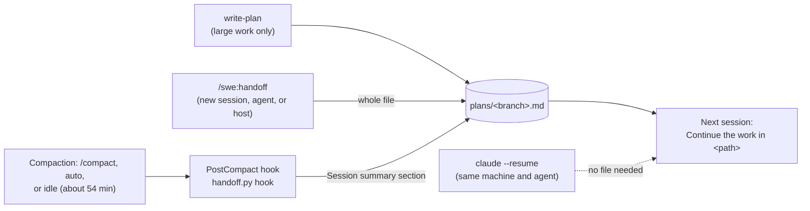

# Handoffs

A handoff file holds the current state of one piece of work, so a new session,
another agent, or another host can continue it. Each branch has one file,
`<main checkout>/.agents/plans/<branch>.md` (`/` changed to `-`). Delete it
when the pull request merges; the code and the pull request are the record.

## Workflow

- **Same machine, same agent:** `claude --resume`. The transcript is the full
  state. Claude Code's idle compaction keeps a resume cheap.
- **New session, other agent, or other host:** run the
  [`handoff`](../plugins/swe/skills/handoff/SKILL.md) skill. The session model
  overwrites the file with Goal, Done, Decisions, Next, Open questions, and
  Branch and PR. Codex has the skill only.
- **Compaction:** the PostCompact hook
  ([`handoff.py hook`](../plugins/swe/scripts/handoff.py)) gets the summary that
  the session model just wrote (`compact_summary`) and puts it in the file's
  `## Session summary` section. It replaces the earlier summary, keeps the rest
  of the file, and makes no model call. It skips `main`, `master`, and a
  detached HEAD.

## Idle compaction

Claude Code 2.1.299 compacts a session that has been idle for about 54 minutes,
before its one-hour prompt cache expires. Every new request resets the timer,
so it runs only when you have left. By default it needs 200,000 tokens of
context; set `CLAUDE_CODE_IDLE_COMPACT_MIN_TOKENS` lower to cover smaller
sessions, or `"idleCompaction": false` to turn it off. See
[`idleCompaction`](https://code.claude.com/docs/en/settings-reference#idlecompaction).
