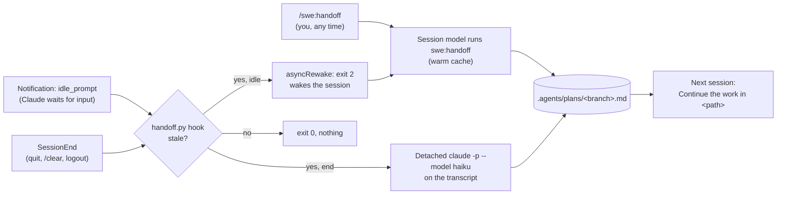

# Handoffs

A handoff file holds the current state of one piece of work, so a new session
can continue it. Each branch has one file,
`<main checkout>/.agents/plans/<branch>.md` (`/` changed to `-`). `write-plan`
can start it as a plan; the [`handoff`](../plugins/swe/skills/handoff/SKILL.md)
skill overwrites it with Goal, Done, Decisions, Next, Open questions, and Branch
and PR. Start the next session with `Continue the work in <path>.`

## Triggers

Each hook gets `session_id`, `transcript_path`, and `cwd` on stdin.
[`handoff.py hook`](../plugins/swe/scripts/handoff.py) finds the branch's file
from `cwd` and reads the transcript.

- **Stale** means the session's newest Edit or Write is less than one hour old
  and later than the file's last change, or the file does not exist. An old
  session that you only open and close has no recent edit, so nothing runs.
- **Idle**: Claude Code sends `idle_prompt` after the prompt waits for 60
  seconds (`messageIdleNotifThresholdMs`). For a stale file, the hook exits 2
  and the session model gets a reminder to run the skill. It reminds once per
  newest edit; a marker file `.reminded-<session>` in the plans directory
  records it.
- **Session end**: the session model is gone, so a detached Haiku process
  writes the file. It runs `claude -p` with `SWE_HANDOFF_CHILD=1`, so its own
  hooks do nothing. When the file changes during the call, it keeps the newer
  file.
- After any write, the file is newer than the last edit, so later idles and
  session ends do nothing until the next edit.

Codex has the skill only; it has no equivalent hooks.

On a Claude subscription, when you resume a session that was idle for more
than about an hour and holds more than 100,000 tokens, Claude Code itself
offers to resume from a summary.
