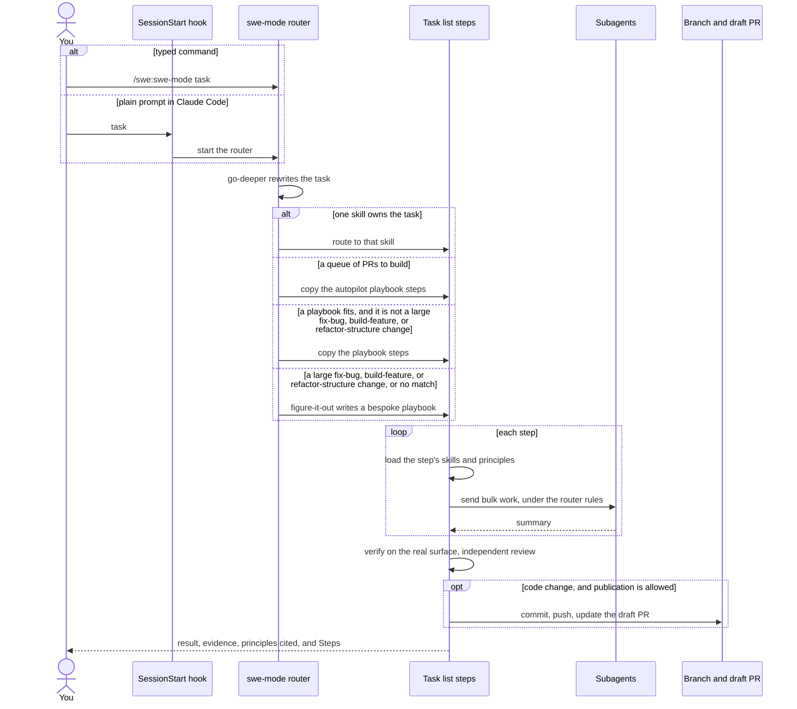

# swe

swe gives the agent one entry point for software work: a router that matches
your task to a playbook, runs each step with the skills and principles that
step needs, and ends with the evidence and the state of every step. The aim is
less code of higher quality, and work you can check without a replay of the
session.

## Install

Each plugin installs alone. Pick one way, then start a new session.

Claude Code plugin:

```text
/plugin marketplace add kpeez/agent-toolbox
/plugin install swe@agent-toolbox
```

Codex CLI plugin:

```text
codex plugin marketplace add kpeez/agent-toolbox
codex plugin add swe@agent-toolbox
```

Antigravity CLI (`agy`):

```text
agy plugin install https://github.com/kpeez/agent-toolbox/tree/main/plugins/swe
```

Skills only, with [`npx skills`](https://github.com/vercel-labs/skills), for
Claude Code, Codex, and other agents that read Agent Skills:

```text
npx skills@latest add https://github.com/kpeez/agent-toolbox/tree/main/plugins/swe
```

This installs the swe skills and no other plugin. Install all of them, because
they read each other by path. Add `-g` to install for your user instead of
the current project. The skills-only install has no hooks and no
agents. [Set up swe](./docs/01-setup.md#install-the-skills-only) says what
changes.

To update:

- Claude Code: `claude plugin marketplace update agent-toolbox`, then
  `claude plugin update swe@agent-toolbox`.
- Codex: `codex plugin marketplace upgrade agent-toolbox`, then
  `codex plugin add swe@agent-toolbox` again.
- agy: run the `agy plugin install` command again. It replaces the old copy.
- npx skills: `npx skills update`.

In Claude Code, a SessionStart hook tells the agent to start the router for
each new software task, so you can also type the task without the command.
A PreToolUse hook blocks `gh pr create` and `gh pr edit` unless the body is
the filled `ship-pr` template, built with `pr_body.ts render`. It also blocks
`gh api` calls that create or edit a pull request. When the
repository uses `gh-stack`, it also blocks a `gh pr create` or `gh pr edit`
whose `--base` is not trunk.
agy runs no hooks, but it loads the same rule from
[`rules/AGENTS.md`](./rules/AGENTS.md). It skips the swe agents. Codex plugins
have no hooks. [Set up swe](./docs/01-setup.md) gives the lines to put in
`AGENTS.md`.

New here? Ask [`/swe:help`](./skills/help/SKILL.md) a question, such as "which
skill reviews a PR?". The [swe guide](./docs/README.md) walks you through a
first real task, from setup and prompts through verification and long runs.

## Usage

`/swe:swe-mode` is the front door to swe. You give it a goal. It matches one
of 21 playbooks, or the one skill that owns the task, copies the steps into
the task list, and loads the other skills as the steps need them. In Codex,
type `$swe:swe-mode` instead.

```text
/swe:swe-mode users get two notifications after a retry. repro first, then fix and verify.
```

```text
/swe:swe-mode i'm stepping away. migrate every caller to the async store, keep behavior identical, and log your decisions.
```

### Know what happens to your prompt



The [router](./skills/swe-mode/SKILL.md#match) first runs
[`go-deeper`](./skills/go-deeper/SKILL.md) on a new task, then matches the
rewritten task in this order:

1. When one skill owns the whole task, it routes to that skill. "Explain this
   crash, no fix" goes to `diagnose`, for example.
2. A queue of PRs to build goes to `autopilot-full` when the PRs are
   independent and should merge, and to `autopilot-stack` when they depend
   on each other or you land them. When you ask for the merge of a
   dependent stack, `autopilot-stack` lands it with `ship-stack` after its
   handoff. This holds also when you are away. A
   request to plan the queue only goes to `plan-multi-phase`.
3. Otherwise it picks the first playbook whose line fits the whole task. The
   list runs from narrow to broad, so `fix-bug` comes before `build-feature`.
   When that playbook is `fix-bug`, `build-feature`, or `refactor-structure`
   and the code change is large, cross-cutting, or a multi-day program, it
   goes to [`figure-it-out`](./skills/figure-it-out/SKILL.md) instead. That
   skill writes a bespoke playbook in the same step format.
4. Work that no playbook fits also goes to `figure-it-out`.

The router says its choice in one line, such as
`Playbook: fix-bug. Reason: a reported defect.` In every step it applies its
rules for triggers, autonomy, and subagent choice. A step it skips stays in
the list as `skip: <reason>`. The final reply gives the result, the evidence,
the principles that changed a decision, and a Steps section with the state of
every step. The full rules are in
[`swe-mode/SKILL.md`](./skills/swe-mode/SKILL.md).

### Say the goal, not the ceremony

You do not write a spec. Say what is wrong or what you want, plus anything
you already know that saves the agent time. The first prompt above routes to
`fix-bug`. "repro first" is a real constraint, and the playbook keeps it.
Watch the task list fill with steps such as `1-reproduce-failure` and
`9-verify-original-repro`.

### Put up to five things in a prompt

A useful prompt carries up to five things. Each one fits in a sentence:

- **The goal.** Say what is wrong, or what you want.
- **The done check.** It must be able to pass or fail. "Make it better" is
  not a check.
- **The proof you want.** Ask for command output, a video, a stored value, or
  a before-and-after number.
- **What you know.** A symptom, a repro step, a log line, or a link saves the
  agent a search.
- **The constraints.** "repro first", "no code change yet", "zero behavior
  change", and "let me review before you go on" each change what the agent
  does.

Here is one prompt with all five:

```text
/swe:swe-mode the csv export drops its last row since yesterday's deploy. failing job id is 4812. repro first, then fix. done means the 60k-row fixture exports every row. show me the row counts before and after.
```

Leave the how out. Say what to achieve, and let the agent find a better path
than the one you would pick. Hold back your theory of the cause at first,
because a stated guess narrows the search to where you pointed.

### Follow up short

When the conversation already holds the context, a follow-up can be one
line, such as `continue` or `keep going until done`. Short works because the
playbook holds the structure. In Claude Code, the SessionStart hook keeps the
router rule in context, so the agent loads the router again for a new task
without the slash command.

### Switch tasks with "new task"

A long chat collects context from the last task. When you change subjects,
say so:

```text
/swe:swe-mode new task. figure out why the cache entry survives logout. don't change any code yet.
```

"new task" makes the router match again instead of continuing the earlier
playbook. "don't change any code yet" keeps this task on a read-only route,
such as the `investigate-question` playbook or the `diagnose` skill.

### Give parallel work its own worktree

Two agents that write to one working tree overwrite each other's files. The
PR step gives each writer its own worktree. When your branch holds unrelated
dirty work, it leaves that work in place and starts a fresh worktree from the
base. To pick the base or the place yourself, say so:

```text
/swe:swe-mode new task. branch off <base> in a fresh worktree, then port the parser change there.
```

Worktrees use disk. When disk gets tight, ask:

```text
/swe:swe-mode what's using my disk? prune the worktrees that are safe to prune.
```

The [`clean-worktrees`](./skills/swe-mode/playbooks/clean-worktrees.md)
playbook runs [worktree_audit.sh](./scripts/worktree_audit.sh) to sort each
worktree by merge state and uncommitted work. It asks you which sessions still
use a worktree, and that answer wins over the audit. It pauses before it
removes any worktree with uncommitted edits. It also lists the agent scratch
folders and deletes those of merged branches after you confirm that list.

### Leave it running

When you step away, say what done means and go:

```text
/swe:swe-mode going to bed. keep going until `uv run pytest` passes on python 3.12 and 3.13. log your decisions.
```

"going to bed", "run until done", and "don't stop" tell the router to keep
going and decide each call itself. A long task routes to
[`run-autonomously`](./skills/swe-mode/playbooks/run-autonomously.md). It
states the exit condition as a check before the first iteration and keeps a
decision log with [`log-decisions`](./skills/log-decisions/SKILL.md). In
Claude Code, it uses `/loop` to wake itself. Codex has no wake mechanism, so
you start the next run yourself. [Run long work](./docs/07-long-runs.md)
covers the full contract.

### Avoid listing skills in your prompt

Do not write "use how, then architect, then blast-radius". The playbook
already orders the skills, and a list you write by hand usually drops or
reorders steps that the playbook keeps. Name a skill only when you want to
override one choice.

### Playbooks

The [playbook directory](./skills/swe-mode/playbooks) has the full set.

<details>
<summary>The 21 playbooks</summary>

| Playbook | Use for |
| --- | --- |
| [fix-bug](./skills/swe-mode/playbooks/fix-bug.md) | A reported defect to reproduce, root-cause, and fix |
| [improve-performance](./skills/swe-mode/playbooks/improve-performance.md) | A measured slowness, against a baseline |
| [hillclimb-metric](./skills/swe-mode/playbooks/hillclimb-metric.md) | Sustained improvement of one metric, keep or revert per attempt |
| [diagnose-runtime](./skills/swe-mode/playbooks/diagnose-runtime.md) | A live runtime symptom (leak, spin, glitch), diagnosis only |
| [diagnose-trace](./skills/swe-mode/playbooks/diagnose-trace.md) | A captured profile, trace, or heap snapshot, diagnosis only |
| [evaluate-agent-change](./skills/swe-mode/playbooks/evaluate-agent-change.md) | Measure how a skill or prompt change affects agent behavior |
| [author-skill](./skills/swe-mode/playbooks/author-skill.md) | Write or edit a skill, `AGENTS.md`, or `CLAUDE.md` |
| [build-prototype](./skills/swe-mode/playbooks/build-prototype.md) | A throwaway sketch that settles a design fork by observation |
| [match-visual-parity](./skills/swe-mode/playbooks/match-visual-parity.md) | Pixel-exact UI equivalence against a baseline |
| [refactor-structure](./skills/swe-mode/playbooks/refactor-structure.md) | Change structure, keep behavior |
| [build-feature](./skills/swe-mode/playbooks/build-feature.md) | New or changed behavior |
| [investigate-question](./skills/swe-mode/playbooks/investigate-question.md) | A read-only question with a cited answer |
| [babysit-pr](./skills/swe-mode/playbooks/babysit-pr.md) | Drive a PR or stack to merge-ready |
| [ship-stack](./skills/swe-mode/playbooks/ship-stack.md) | Verify a green stack, then land it with `gh stack merge` or bottom-up to the ceiling |
| [run-autonomously](./skills/swe-mode/playbooks/run-autonomously.md) | Drive a long task to a checkable exit condition |
| [plan-multi-phase](./skills/swe-mode/playbooks/plan-multi-phase.md) | Write a plan for work across phases or stacked PRs |
| [autopilot-full](./skills/swe-mode/playbooks/autopilot-full.md) | A queue of independent PRs, run to merged |
| [autopilot-stack](./skills/swe-mode/playbooks/autopilot-stack.md) | Autopilot-full without the merge: verified PRs you land, or a dependent stack it lands with `ship-stack` when you ask for the merge |
| [pick-up-session](./skills/swe-mode/playbooks/pick-up-session.md) | Resume a prior agent's in-flight work |
| [pause-safely](./skills/swe-mode/playbooks/pause-safely.md) | Stop in-flight work so a new session can resume it |
| [clean-worktrees](./skills/swe-mode/playbooks/clean-worktrees.md) | Reclaim disk from merged or abandoned worktrees |

</details>

## Skills

The router runs most skills for you when a step needs them. Type one directly
when you want only that job:

```text
/swe:how how do we cancel runs? is there an n+1 when we look up each run?
```

```text
/swe:blast-radius what else could this diff break?
```

Each command shows its arguments: `<x>` is required and `[x]` is optional.
Claude Code shows the same hint when you type the command. In Codex, type `$`
in place of `/`.

<details>
<summary>Skills in the model's skill list</summary>

Each of these also starts on its own when its task comes up.

| Command | Use it when |
| --- | --- |
| [`/swe:interview-user [plan or decision]`](./skills/interview-user/SKILL.md) | A plan or design has open decisions only you can make |
| [`/swe:handoff`](./skills/handoff/SKILL.md) | You want the work's current state saved for a new session |
| [`/swe:log-decisions`](./skills/log-decisions/SKILL.md) | You want an append-only decision log for a long or unattended run |
| [`/swe:implement <feature or fix>`](./skills/implement/SKILL.md) | You approved a feature or fix and want it built and verified |
| [`/swe:diagnose <symptom or failing check>`](./skills/diagnose/SKILL.md) | You want the cause of a bug or a performance regression |
| [`/swe:verifying-work [change, diff, or behavior]`](./skills/verifying-work/SKILL.md) | You want the strongest check for a change: model check, types, lint, end-to-end, property test, or unit test |
| [`/swe:test-audit [tests, path, or diff]`](./skills/test-audit/SKILL.md) | You want flaws found in a test suite: missed states, tests that check implementation, duplicates, and checks weaker than the risk needs. Then it fixes the findings you approve |
| [`/swe:codebase-design <interface or module>`](./skills/codebase-design/SKILL.md) | You design a new interface, or want deeper module boundaries proposed |
| [`/swe:blast-radius [diff, branch, or PR]`](./skills/blast-radius/SKILL.md) | You want to know what a change could break beyond its diff |
| [`/swe:why <code, config, or decision>`](./skills/why/SKILL.md) | You want to know why code or a decision exists |
| [`/swe:correct <repeated mistake>`](./skills/correct/SKILL.md) | Agents keep making the same mistake |
| [`/swe:ship-pr [PR number or action]`](./skills/ship-pr/SKILL.md) | You want a commit, a push, and a draft PR driven to green |
| [`/swe:verification-skill [app or surface]`](./skills/verification-skill/SKILL.md) | Your project has no scripted way to run and observe the real app |
| [`/swe:external-agents <task>`](./skills/external-agents/SKILL.md) | You want workers on another agent CLI, OpenCode (Zen, Go, Copilot) or Antigravity (Gemini): a swarm of small questions, or a whole spec to build that Claude then reviews |
| [`/swe:writing <document or path>`](./skills/writing/SKILL.md) | You write prose: docs, PR bodies, handoffs, plans, or replies |
| [`/swe:writing-for-agents <skill or AGENTS.md path>`](./skills/writing-for-agents/SKILL.md) | You write a skill, `AGENTS.md`, or `CLAUDE.md` |
| [`/swe:wait-what`](./skills/wait-what/SKILL.md) | You want the last message again in simpler words |

</details>

<details>
<summary>Skills hidden from the model's skill list</summary>

Playbook steps and router triggers read these by path. You can still type
them, such as `/swe:how`.

| Command | Use it when |
| --- | --- |
| [`/swe:help [question]`](./skills/help/SKILL.md) | You want to know which swe skill, playbook, or principle fits |
| [`/swe:how <subsystem or question>`](./skills/how/SKILL.md) | You want a walkthrough of how a subsystem works. Nothing routes to it. It starts one read-only subagent |
| [`/swe:architect <feature or interface>`](./skills/architect/SKILL.md) | You want a design shape picked before code |
| [`/swe:swarm <task>`](./skills/swarm/SKILL.md) | You want parallel workers: coverage matrices, races, or verifier lanes |
| [`/swe:figure-it-out <task>`](./skills/figure-it-out/SKILL.md) | No playbook fits, and you want a bespoke one |
| [`/swe:create-formal-verification-skill [area or bug]`](./skills/create-formal-verification-skill/SKILL.md) | Tests cannot reach the case that breaks a race, retry, state machine, or parser |
| [`/swe:maintain-formal-verification-skill [verify skill or area]`](./skills/maintain-formal-verification-skill/SKILL.md) | Code that a formal verification covers changed without a recheck |
| [`/swe:statechart [behavior or spec]`](./skills/statechart/SKILL.md) | Someone must see how a system moves between states, such as a product flow, a protocol, or a service, as a chart checked by a TLA+ model, with the shortest path to each state that breaks a rule |
| [`/swe:benchmark-checklist <number and how you measured it>`](./skills/benchmark-checklist/SKILL.md) | You measured a number and want it vetted before you report it |
| [`/swe:go-deeper <task>`](./skills/go-deeper/SKILL.md) | You want a task made deeper, not bigger: expert moves, raw sources, real methods, and an outside check. It also runs on its own at the start of a new task |
| [`/swe:no-comments [path or diff]`](./skills/no-comments/SKILL.md) | You want comments that do not explain a non-obvious why removed |
| [`/swe:ketchup`](./skills/ketchup/SKILL.md) | You come back after time away and want to catch up |
| [`/swe:ketchup-video`](./skills/ketchup-video/SKILL.md) | You want the catch-up as a short subtitled video of slides, with the waiting calls as text under it |
| [`/swe:recall [topic]`](./skills/recall/SKILL.md) | You want recent context rebuilt from chat history and the tracker issue |
| [`/swe:reflect`](./skills/reflect/SKILL.md) | You want a session reviewed for agent mistakes |
| [`/swe:in-your-own-words`](./skills/in-your-own-words/SKILL.md) | You want the agent to restate your goal before it starts |
| [`/swe:typescript-best-practices`](./skills/typescript-best-practices/SKILL.md) | You read or edit TypeScript. It also loads on its own for `.ts` and `.tsx` files |

</details>

## Agents

The chat that runs `/swe:swe-mode` owns the playbook, the task list, and every
subagent. swe ships one agent:
[`comment-sicko`](./agents/comment-sicko.md) reviews a diff for comments to
delete. `no-comments` starts it.

Code, review, and search delegates use the host's own subagents. Each one
reads [worker.md](./skills/swe-mode/worker.md) first. A reviewer also gets the
[review brief](./references/review-brief.md).

## Principles

The 25 principles are short hidden skills, one rule each. The router lists each
one with the moment it applies, and reads it by path at that step. Name one in
a prompt to steer the agent, as in "fix the root cause, not the symptom".
[Steer with principle names](./docs/08-principles.md) shows how.

<details>
<summary>The 25 principles</summary>

| Principle | Group | Rule |
| --- | --- | --- |
| [laziness-protocol](./skills/principle-laziness-protocol/SKILL.md) | core | Bias toward deletion and the smallest change that solves the problem. |
| [foundational-thinking](./skills/principle-foundational-thinking/SKILL.md) | core | Choose the core types and data structures before logic, so the downstream code becomes obvious. |
| [redesign-from-first-principles](./skills/principle-redesign-from-first-principles/SKILL.md) | core | Redesign as if a new requirement had been there from the start. |
| [attack-the-premise](./skills/principle-attack-the-premise/SKILL.md) | core | When two fixes that share one premise fail the same check, write the premise down and test it. |
| [subtract-before-you-add](./skills/principle-subtract-before-you-add/SKILL.md) | core | Remove dead code and redundant checks first, then build on the simpler base. |
| [minimize-reader-load](./skills/principle-minimize-reader-load/SKILL.md) | core | Count the layers and state a reader must hold, then collapse wrappers. |
| [outcome-oriented-execution](./skills/principle-outcome-oriented-execution/SKILL.md) | core | In a planned migration, converge on the target with no throwaway compatibility code. |
| [experience-first](./skills/principle-experience-first/SKILL.md) | core | Choose the user's experience over implementation convenience. |
| [exhaust-the-design-space](./skills/principle-exhaust-the-design-space/SKILL.md) | core | With no precedent, build two or three competing prototypes and compare them. |
| [build-the-lever](./skills/principle-build-the-lever/SKILL.md) | core | Build the script, codemod, or generator that does or proves the work. |
| [model-the-domain](./skills/principle-model-the-domain/SKILL.md) | architecture | Encode the domain in a data structure instead of scattered conditionals. Find implicit state machines in existing code. |
| [boundary-discipline](./skills/principle-boundary-discipline/SKILL.md) | architecture | Guard at system boundaries, trust internal types, keep business logic pure. |
| [type-system-discipline](./skills/principle-type-system-discipline/SKILL.md) | architecture | Make the compiler reject impossible states and unhandled variants. |
| [make-operations-idempotent](./skills/principle-make-operations-idempotent/SKILL.md) | architecture | Make every rerun reach the same end state. |
| [migrate-callers-then-delete-legacy-apis](./skills/principle-migrate-callers-then-delete-legacy-apis/SKILL.md) | architecture | Migrate every caller and delete the old API in the same change. |
| [separate-before-serializing-shared-state](./skills/principle-separate-before-serializing-shared-state/SKILL.md) | architecture | Remove shared writes before you add a lock. |
| [prove-it-works](./skills/principle-prove-it-works/SKILL.md) | verification | Check the real artifact and give a VERIFIED, NOT VERIFIED, or INCONCLUSIVE verdict. |
| [fix-root-causes](./skills/principle-fix-root-causes/SKILL.md) | verification | Trace each symptom to the first place the system went wrong and fix it there. |
| [sequence-verifiable-units](./skills/principle-sequence-verifiable-units/SKILL.md) | verification | Split work into small units and check each before the next. |
| [test-behavior-not-implementation](./skills/principle-test-behavior-not-implementation/SKILL.md) | verification | Assert what users observe, so the test fails when behavior breaks and passes when internals change. |
| [explain-the-number](./skills/principle-explain-the-number/SKILL.md) | verification | Find what limits a measured number before you trust or report it. |
| [guard-the-context-window](./skills/principle-guard-the-context-window/SKILL.md) | delegation | Send bulk work to subagents and keep summaries in the main thread. |
| [never-block-on-the-human](./skills/principle-never-block-on-the-human/SKILL.md) | delegation | Do reversible work, show the result, and let the human correct it. |
| [encode-lessons-in-structure](./skills/principle-encode-lessons-in-structure/SKILL.md) | meta | Encode a repeated rule as a lint, flag, check, or script. |
| [ancillary-fixes](./skills/principle-ancillary-fixes/SKILL.md) | meta | For an issue outside the task, decide to fix it now or report it. |

</details>
