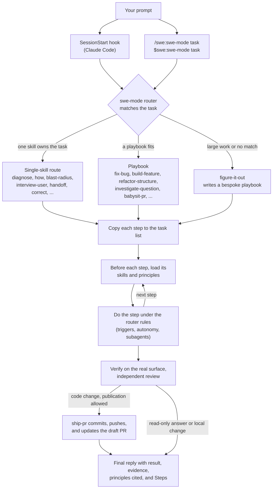

# Route work through /swe:swe-mode

`/swe:swe-mode` is the front door to swe. You give it a goal. It matches one of 22 playbooks, or the one skill that owns the task, copies the steps into the task list, and loads the other skills as the steps need them. This page shows what a good prompt holds and how little of one you need. In Codex, type `$swe:swe-mode` instead.

## Know what happens to your prompt



The [router](../skills/swe-mode/SKILL.md#match) first runs [`go-deeper`](../skills/go-deeper/SKILL.md) on a new task, then matches the rewritten task in this order:

1. When one skill owns the whole task, it routes to that skill. "Explain how a subsystem works, no code change" goes to `how`, for example.
2. Otherwise it picks the first playbook whose line fits. The list runs from narrow to broad, so `fix-bug` comes before `build-feature`.
3. Large or cross-cutting work, work you step away from, or work that no playbook fits goes to [`figure-it-out`](../skills/figure-it-out/SKILL.md). It writes a bespoke playbook in the same step format.

The router says its choice in one line, such as `Playbook: fix-bug. Reason: a reported defect.` The [playbook directory](../skills/swe-mode/playbooks) has the full set.

## Say the goal, not the ceremony

You do not write a spec. Say what is wrong or what you want, plus anything you already know that saves the agent time:

```text
/swe:swe-mode users get two notifications after a retry. repro first, then fix and verify.
```

That prompt routes to `fix-bug`. "repro first" is a real constraint, and the playbook keeps it. Watch the task list fill with steps such as `1-reproduce-failure` and `9-verify-original-repro`.

## Put up to five things in a prompt

A useful prompt carries up to five things. Each one fits in a sentence:

- **The goal.** Say what is wrong, or what you want.
- **The done check.** It must be able to pass or fail. "Make it better" is not a check.
- **The proof you want.** Ask for command output, a video, a stored value, or a before-and-after number.
- **What you know.** A symptom, a repro step, a log line, or a link saves the agent a search.
- **The constraints.** "repro first", "no code change yet", "zero behavior change", and "let me review before you go on" each change what the agent does.

Here is one prompt with all five:

```text
/swe:swe-mode the csv export drops its last row since yesterday's deploy. failing job id is 4812. repro first, then fix. done means the 60k-row fixture exports every row. show me the row counts before and after.
```

Leave the how out. Say what to achieve, and let the agent find a better path than the one you would pick. Hold back your theory of the cause at first, because a stated guess narrows the search to where you pointed.

## Follow up short

When the conversation already holds the context, a follow-up can be one line:

```text
continue
```

```text
keep going until done
```

Short works because the playbook holds the structure. In Claude Code, the SessionStart hook keeps the router rule in context, so the agent loads the router again for a new task without the slash command.

## Switch tasks with "new task"

A long chat collects context from the last task. When you change subjects, say so:

```text
/swe:swe-mode new task. figure out why the cache entry survives logout. don't change any code yet.
```

"new task" makes the router match again instead of continuing the earlier playbook. "don't change any code yet" keeps this task on a read-only route, such as the `investigate-question` playbook or the `diagnose` skill.

## Give parallel work its own worktree

Two agents that write to one working tree overwrite each other's files. [`ship-pr`](../skills/ship-pr/SKILL.md) gives each writer its own worktree. When your branch holds unrelated dirty work, it leaves that work in place and starts a fresh worktree from the base. To pick the base or the place yourself, say so:

```text
/swe:swe-mode new task. branch off <base> in a fresh worktree, then port the parser change there.
```

Worktrees use disk. When disk gets tight, ask:

```text
/swe:swe-mode what's using my disk? prune the worktrees that are safe to prune.
```

The [`clean-worktrees`](../skills/swe-mode/playbooks/clean-worktrees.md) playbook runs [worktree_audit.sh](../scripts/worktree_audit.sh) to sort each worktree by merge state and uncommitted work. It asks you which sessions still use a worktree, and that answer wins over the audit. It pauses before it removes any worktree with uncommitted edits.

## Leave it running

When you step away, say what done means and go:

```text
/swe:swe-mode going to bed. keep going until the migration check reports zero old callers. log your decisions.
```

"going to bed", "run until done", and "don't stop" tell the router to keep going and decide each call itself. A long task routes to [`run-autonomously`](../skills/swe-mode/playbooks/run-autonomously.md). It states the exit condition as a check before the first iteration and keeps a decision log with [`log-decisions`](../skills/log-decisions/SKILL.md). In Claude Code, it uses `/loop` to wake itself. Codex has no wake mechanism, so you start the next run yourself. [Run long work](07-long-runs.md) covers the full contract.

## Avoid listing skills in your prompt

Do not write "use how, then architect, then blast-radius". The playbook already orders the skills, and a list you write by hand usually drops or reorders steps that the playbook keeps. Name a skill only when you want to override one choice.

Read the [router](../skills/swe-mode/SKILL.md) itself for the full rules.

Next: [Understand the code](03-understand.md).
