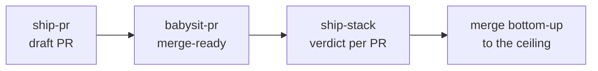

# Verify the result and ship it

This page shows you how to make the agent prove a change on the real app, vet a measured number, and take the change from a draft PR to merged. "It compiles" is not evidence. The [prove-it-works principle](../skills/principle-prove-it-works/SKILL.md) makes the agent check the real artifact through its real entry point before it reports success. Your job is to make that artifact checkable.

## State the finish condition up front

Put what done means in the first prompt:

```text
/swe:swe-mode add json output to the export command. the text output stays byte-identical, the json parses, and both run against the sample project. show me the evidence.
```

Now the agent has three checks it can run. Each change ends with one verdict:

- VERIFIED means the agent saw the expected behavior on the real surface.
- NOT VERIFIED means it saw wrong behavior, or the check failed.
- INCONCLUSIVE means it could not reach the real surface, or the check cannot tell success from failure. INCONCLUSIVE is not a pass.

Match the check to the change. A CLI change runs the real command. A UI change walks the changed flow in the running app. A parser or migration replays a saved input. A storage change reads back the written value. A perf change compares before and after artifacts. Ask for proof you can inspect yourself, such as command output, a screenshot, a video, or a script a reviewer can rerun.

## Check what a change could break

For a diff you do not fully trust, ask what it breaks outside the diff:

```text
/swe:blast-radius what could the cache eviction change break?
```

[`blast-radius`](../skills/blast-radius/SKILL.md) finds the one fact the change is safe because of, then proves that fact by running real code. It grades the proof on five rungs: `asserted`, `cited`, `traced`, `executed`, and `reproduced-live`. The reply says where the proof stopped. The `build-feature` playbook runs it when a change touches shared state, a wire format, or a public interface.

## Vet a measured number

A warm cache, a debug build on one side, or work that never ran in the timed region can each produce a false speedup. Before you report or act on a number, type:

```text
/swe:benchmark-checklist vet the export speedup before it goes in the pr
```

[`benchmark-checklist`](../skills/benchmark-checklist/SKILL.md) asks seven questions and wants evidence from a run for each:

1. Why not double? Name the limiter.
2. Did every side run tuned the way production runs?
3. Does the result break a physical limit, such as disk bandwidth or core count?
4. Did anything error or return wrong output?
5. Does it reproduce over at least 5 alternating runs per side, with a median and a range?
6. Does it matter on the end-to-end path a user waits on?
7. Did the work happen inside the timed region?

The verdict is faster, slower, no measurable difference, or inconclusive. It comes with the run count, the range, and the limiter. The router runs this checklist on every number the agent measures, and the `improve-performance` and `hillclimb-metric` playbooks run it on their baseline and harness. Type it yourself for a number from outside a swe run.

## Create a verification skill for your app

A UI or app check needs a scripted way to drive the app. When your project has none, run:

```text
/swe:verification-skill
```

In Codex, type `$swe:verification-skill`. The [`verification-skill`](../skills/verification-skill/SKILL.md) skill reads the repository and asks you only what the code cannot answer. It writes a project-local `verify-<app>` skill in `.agents/skills/`. Your repository's setup step links `.claude/skills` to `.agents/skills` so Claude Code finds it too; the link is not committed. The skill has Launch, Doctor, Drive, Evidence, and Cleanup sections, plus a feature map under `features/` with one file per user-facing feature. See the [feature-map example](../skills/verification-skill/references/feature-map-example/README.md). Before it hands over, the generator runs the new skill once end to end on one feature.

After that, every verify step in a playbook uses the skill. Name it in a prompt when you want the proof in a specific form:

```text
/swe:swe-mode build the bulk-archive action. use verify-<app> to prove it and show me screenshots.
```

Commit the verification skill so every person and agent drives the app the same way.

## Keep the verification skill current

Run `/swe:verification-skill` again when the skill already exists, and it audits the skill instead. It checks each feature from source in parallel, then drives every feature live. It ends in one outcome. `clean` means nothing to ship. `changed` means proven corrections to the skill's own folder. `blocked` names the blocker. It never edits product code, and it reports a product regression instead of hiding it in the docs.

When a change adds or changes a user-facing feature, the agent updates that feature's entry in the map as part of the change.

## Verify what tests cannot reach

Some bugs need one rare order of events or one input that no test tries: a race, a retry, a state machine, a parser. Type:

```text
/swe:create-formal-verification-skill
```

The [`create-formal-verification-skill`](../skills/create-formal-verification-skill/SKILL.md) skill picks the property where a break costs the most and tests reach the least. It verifies that property with the tool that fits, such as TLA+ for a bad order of events in any language, or an SMT-backed verifier for every input. When no verifier runs on your language, it says so and tests the real code with generated inputs. It shows each check failing on a broken variant first. It reports a break in the current code as a finding and does not weaken the check. Then it writes a project-local skill in `.agents/skills/<skill-name>/` that reruns the check on each change. The skill folder holds the model or proof files and the runner scripts, so the repository has no top-level `formal/` directory. Commit the skill folder; the `.claude/skills` link stays uncommitted. One `just` or `make` recipe runs the check, and `AGENTS.md` names it for agents that do not load skills. See [project skill layout](../references/project-skill-layout.md). Name an area or a bug to start there.

The generated skill records which code each check covers and the sync commit: the commit where the check last matched the code. A merge or a refactor that skips the skill can leave the check passing on code that is gone. After such changes, type `/swe:maintain-formal-verification-skill`. The [`maintain-formal-verification-skill`](../skills/maintain-formal-verification-skill/SKILL.md) skill updates the verification from the code, reruns it, shows that each updated check can still fail, and says whether each failure is drift in the verification or a bug in the code.

## Show the behavior as a statechart

A counterexample in model terms convinces you. The PM or designer who owns the behavior must see it in their terms. Type:

```text
/swe:statechart what the user sees when they edit a note offline
```

The [`statechart`](../skills/statechart/SKILL.md) skill draws a Mermaid statechart of what the user sees from a TLA+ model, so the chart and the checked model cannot drift apart. Each rule of the reader, such as "you never see Synced while you are offline", becomes an invariant. Each bug that TLC finds is a numbered path in the reader's words. Each state is marked works, still wrong, or fixed by your open PR. Before the handoff, the agent reproduces each bug path in the real code, so a modeling error does not reach the reader as a bug.

It also works in the other direction. Draw the behavior as a chart and agree on it with the reader. The skill writes a TLA+ skeleton from the chart, and TLC checks the chart's rules before any code exists. When guards from the real code go into the spec, each place where the code departs from the chart shows as a difference for the reader to decide.

When the code already has a TLA+ spec, the skill can audit the code against it. The agent models what the code does and checks that model next to the unchanged spec. The chart marks the steps where the two differ.

The scripts need Node and TLC: set `TLA2TOOLS` to the path of `tla2tools.jar` from a [TLA+ release](https://github.com/tlaplus/tlaplus/releases), and have Java 11 or later.

## Match a UI to a baseline

For a UI that must match a reference pixel for pixel, use the [`match-visual-parity`](../skills/swe-mode/playbooks/match-visual-parity.md) playbook. It builds a screenshot harness of the current component in each state first. Then it migrates one component at a time and diffs each against its baseline. A nonzero diff is a fail, and the agent never edits the baseline to make a diff pass.

## Diagnose a live symptom or a captured trace

To find the cause of a leak, a CPU spin, or a glitch in a running process, the [`diagnose-runtime`](../skills/swe-mode/playbooks/diagnose-runtime.md) playbook captures a profile, heap snapshot, or trace on the real surface. When you already have a capture, the [`diagnose-trace`](../skills/swe-mode/playbooks/diagnose-trace.md) playbook loads it into sqlite and queries it. Both deliver a cited diagnosis with a source location, not a fix.

## Open the PR

```text
/swe:swe-mode open the pr. small ordered commits, evidence in the description.
```

The [`ship-pr`](../skills/ship-pr/SKILL.md) skill owns commits, pushes, and PRs. It acts only when your request or your standing instructions authorize publication. Typing `/swe:swe-mode` alone does not authorize it. It verifies the work, commits small ordered groups, pushes without force, and opens a draft PR. The title uses the Conventional Commits form, such as `fix(parser): reject empty headers`. The body follows the [PR body template](../skills/ship-pr/references/pr-body.md), with Why, What changed, Scope, Tradeoffs, Blast Radius, and Verification sections.

Opening a PR does not start a babysit. The agent posts the URL and keeps building.

## Drive the PR to merge-ready

An open PR collects failed checks, review comments, and conflicts. Hand them to the [`babysit-pr`](../skills/swe-mode/playbooks/babysit-pr.md) playbook:

```text
/swe:swe-mode babysit this pr. get it green.
```

It declares a mode first: `drive` (loop to merge-ready), `background`, `threads-only`, or `check` (one status pass). It works conflicts, then review threads, then CI, and batches every fix into one push. It classifies each failed check before a rerun, and it triages each bot comment as fix, dismiss, or ask. In Claude Code it watches with `gh pr checks <pr> --watch` or `/loop`. In Codex you rerun the pass by hand. For status only, ask smaller:

```text
/swe:swe-mode check on pr 123. anything outstanding?
```

Babysit stops at merge-ready. It never merges.

## Land the stack

Green is not safe. When you want the change merged, say so:

```text
/swe:swe-mode land the stack.
```

The [`ship-stack`](../skills/swe-mode/playbooks/ship-stack.md) playbook gives each PR its own verifier, an agent that did not write the code. The verifier runs the change as a user would and records `PASS`, `PASS+NOTES`, or `FAIL`, keyed to the patch-id. Then ship-stack lands the contiguous verified run from the bottom, one PR at a time, and stops at the first unverified PR. A verified PR above an unverified one waits.



To mark a draft ready for human review without a merge, type `/swe:ship-pr finalize`.

Next: [Run long work and hand it off](07-long-runs.md).
