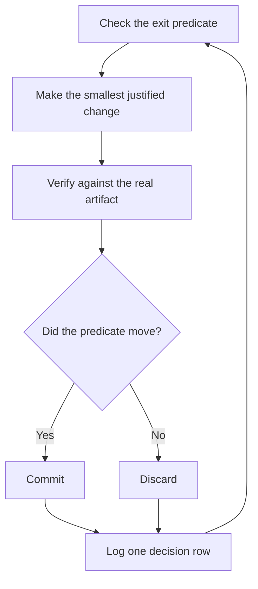
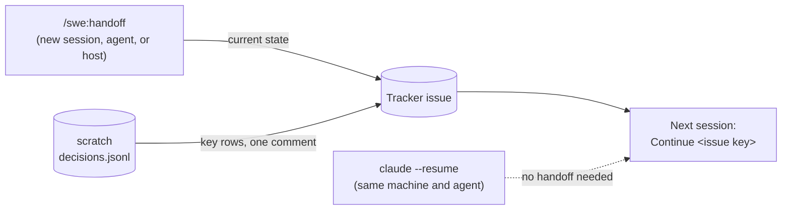

# Run long work and hand it off

This page shows you how to leave an agent on a long task, audit what it decided, and move work between sessions, agents, and hosts. It also covers queues of PRs, delegation, and where swe keeps its files. A run you can leave alone needs a checkable finish condition, an isolated worktree, and a decision log you can read when you come back.

## Drive one task to an exit condition

Give the run a goal, a predicate that can pass or fail, permissions, and a way out:

```text
/swe:swe-mode going to bed. work in a fresh worktree off <base>.
done means `uv run pytest` passes on python 3.12 and 3.13 and the lint check is clean.
keep a decision log. commit without asking me.
if you are truly stuck after a few hours, stop and write up why.
```

"Going to bed" is a session override. The agent stops asking and decides each call itself, then reports it. The [`run-autonomously`](../skills/swe-mode/playbooks/run-autonomously.md) playbook states the exit predicate first. In Claude Code it wakes itself with `/loop`, or with a background watcher such as `gh pr checks <pr> --watch` when there is an event to watch. In Codex you rerun the task by hand. Each iteration follows the same loop:



A plateau means pivot, not stop. The agent never relaxes the predicate to declare victory. A duration is not a predicate. "Work on this for 4 hours" gives the agent nothing to check.

A large or cross-cutting code change, or a multi-day program of one, goes to [`figure-it-out`](../skills/figure-it-out/SKILL.md) in place of `fix-bug`, `build-feature`, or `refactor-structure`. A migration of every caller to a new API is such a change. Work that no playbook fits also goes to `figure-it-out`. Stepping away alone does not pick it. It designs the run's phases before any code and keeps the decision log.

## Keep a decision log

For a long, multi-phase, or unattended run, the [`log-decisions`](../skills/log-decisions/SKILL.md) skill keeps an append-only log in the branch's scratch folder: `.agents/scratch/<branch-slug>/decisions.jsonl`, with `/` in the branch changed to `-`. The model appends each row itself; no script writes the log. Each line is one decision with `ts`, `step`, `decision`, and `reason`:

```json
{"ts": "2026-11-18T12:30:00-08:00", "step": "frame", "decision": "Split the migration into 3 PRs", "reason": "Each PR stays reviewable"}
```

Read the log with `jq -c . <log>` or, in Nushell, `open --raw <log> | from json --objects`. To correct a row, the agent appends a row that supersedes it. A new session that adds to the log starts with a `start` row.

Before the agent hands back, a reviewer on a different model reads the log and the transcript. The reply ends with an "Attention" section. Its first line is `reviewed by <model>`, then each flag with the rows it points to. Read that section first. To get a summary when you return, type `/swe:ketchup`.

At handoff, the log's key rows go to the work's tracker issue as one comment, and the log file is deleted. When a reviewer needs the trail to trust the result, copy the rows into the pull request first.

## Hand work to a new session

A handoff writes the current state of one piece of work to its tracker issue, so a new session, another agent, or another host can continue it. The issue holds the state, what landed, what is next, and the open decisions. The code and the pull request are the record; no handoff file exists.



- **Same machine, same agent.** Run `claude --resume`. The transcript is the full state. Claude Code's idle compaction keeps a resume cheap.
- **New session, other agent, or other host.** Run the [`handoff`](../skills/handoff/SKILL.md) skill. It updates the issue with the current state, posts the decision log's key rows as one comment, deletes the log, and gives you the prompt `Continue <issue key>.` for the new session. With no tracker, the state goes into one pull request comment; with neither, the prompt stands alone.
- **Compaction.** A compaction summary stays in the session transcript. No hook writes it to a file. The decision log and the issue hold the state a new session needs.

## Let idle compaction run

Claude Code 2.1.299 compacts a session that has been idle for about 54 minutes, before its one-hour prompt cache expires. Every new request resets the timer, so it runs only when you have left. By default it needs 200,000 tokens of context. Set `CLAUDE_CODE_IDLE_COMPACT_MIN_TOKENS` lower to cover smaller sessions, or set `"idleCompaction": false` to turn it off. See [`idleCompaction`](https://code.claude.com/docs/en/settings-reference#idlecompaction).

## Pause and pick up

To stop a run on purpose, say so, or say that you are going offline or restarting. The [`pause-safely`](../skills/swe-mode/playbooks/pause-safely.md) playbook finishes or backs out of the current step and commits a local `wip:` commit. Then it runs the handoff skill to write the resume state to the work's tracker issue. It opens no PR. "Keep going" never triggers a pause.

```text
/swe:swe-mode pick up the work on this branch.
```

The [`pick-up-session`](../skills/swe-mode/playbooks/pick-up-session.md) playbook reads the tracker issue and the scratch decision log first, then this project's transcripts or the pushed branch. It names the resume point, does not redo finished work, and verifies inherited claims on the real artifact.

## Run a queue of PRs

The [`autopilot-full`](../skills/swe-mode/playbooks/autopilot-full.md) playbook runs a queue of independent PRs to merged. Each PR gets one owner agent from build to merge. A swarm of verifiers that never wrote the code proves the code-ready head. A later rebase or minor fix gets one fresh verifier, and only new behavior or a large new diff calls the full swarm again. Nothing merges without a clean verdict on the patch that lands.

```text
/swe:swe-mode full autopilot on this queue. each item is independent. merge them when verified.
```

The [`autopilot-stack`](../skills/swe-mode/playbooks/autopilot-stack.md) playbook is `autopilot-full` without the merge. You get verified PRs, each with its verdict, and you land them yourself. A PR stacks only on a PR it builds on. Pick it when you want to review before anything merges. PRs that depend on each other also go to `autopilot-stack` when you ask for the merge. It then lands the stack with `ship-stack` after the handoff.

## Clean up worktrees

```text
/swe:swe-mode clean up merged worktrees.
```

The [`clean-worktrees`](../skills/swe-mode/playbooks/clean-worktrees.md) playbook runs [`worktree_audit.sh`](../scripts/worktree_audit.sh), asks you which sessions are in use, and pauses on uncommitted work. It removes only confirmed worktrees, deletes the agent scratch folders of merged branches that you confirm, and reports `df -h /` before and after.

## Delegate work

The router's Subagents section sets the rules. The chat that runs the playbook owns it, code goes to delegates, and each new round goes to a fresh subagent. In Claude Code the router picks `opus` for judgment and the hardest code, `sonnet` for routine code, and `haiku` for mechanical edits. In Codex it sets reasoning effort the same way.

`implement` fans out large work with independent parts through [`swarm`](../skills/swarm/SKILL.md). Code delegates go to the [`daedalus`](../agents/daedalus.md) agent, which publishes nothing without explicit authority. Every subagent that `swe-mode` starts reads [`worker.md`](../skills/swe-mode/worker.md) first. It holds your rules for started agents. The kickoff's bar is the whole bar. The agent decides reversible calls instead of asking you. It publishes PRs as the [`ship-pr`](../skills/ship-pr/SKILL.md) skill says. The swe README lists [both swe agents](../README.md#agents).

Reviews and searches use the host's own subagents, with the rules in the [review brief](../references/review-brief.md). By default a reviewer fixes small, sure findings and reports each fix. A landing verdict edits nothing.

## Find the project files

| Files | Location |
| --- | --- |
| Notes, research | `.agents/docs/notes/` and `.agents/docs/research/`, unless the project or user names another place. It can be a folder or a symlink, tracked or ignored. |
| Plans | `.agents/docs/plans/<slug>.plan.src.html` when the project has a `.agents/docs` folder, else `.agents/scratch/<branch-slug>/`. See [plan storage](../references/plan-storage.md). |
| Decision logs | `.agents/scratch/<branch-slug>/decisions.jsonl`, one per branch. The handoff posts the key rows to the tracker issue and deletes the file. |
| Handoffs | The work's tracker issue. With no tracker, one pull request comment. |

Next: [Steer with principle names](08-principles.md).
