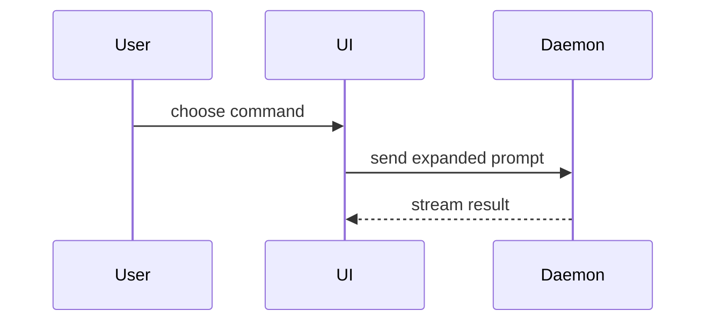

# Pull-request body template

Use this shape for the body. Omit the reviewer's guide when the diff is small
enough to read in order. End with the issue line from `6-link-issue` of the
Publish procedure when one applies.

Write for a reviewer without session context. Skip preambles, keep prose
brief, and use the project's domain terms:

- **Summary:** the concrete problem, resulting behavior, and load-bearing
  approach, shown with the smallest visual that makes the point: real
  before-and-after code from the diff when the code is the point, and a sketch
  when the point spans many files.
- **Reviewer's guide, when useful:** the most important diff first, sensible
  reading order, and any mechanical sections.
- **Evidence:** a before and after for each behavior the PR claims. Never list
  lint, type-check, build, or test-suite runs as evidence. Every PR must pass
  them, so they prove nothing about this one. State known gaps and pre-existing
  failures, and distinguish recorded prior results from checks run in the
  current workspace.
- **Risk:** what the merge can affect, and anything a revert would not undo.

Keep the text self-contained. Beyond the closing `Fixes` line, public text
does not reveal tracker URLs, issue or plan content, or internal workflow
commentary.

````markdown
## Summary

<one or two sentences of what and why>

<real code excerpt, diagram, diff sketch, or tree, each with a one-line caption>

## Reviewer's guide

<most important diff first, reading order, mechanical sections>

## Evidence

- **Before:** <screenshot, output, or failing test>
  **After:** <screenshot, output, or passing test>

Verification record (optional): <PASS | PASS+NOTES | FAIL>; head `<sha>`;
base `<sha>`; patch-id `<id>`.

## Risk

<what the merge can affect; anything a revert would not undo>
````

## Summary

Pick the smallest view that makes the key point clear. Show real code when
the reviewer needs to see the code; use a sketch when the point is a shape that
spans many files. Give each visual a one-line caption that says what to notice.
Keep only the calls, files, props, states, and boundaries a reviewer needs.
Usually one visual is enough; several is fine when each makes a different point.

### Real code

Excerpt the load-bearing change from the actual diff: 5 to 20 lines, with the
path in the caption. Use a `diff` block for a small change inside existing
code. When the code is rewritten, show a before block and an after block with
the language tag, so both keep syntax highlighting:

**`src/save.ts`: save skips the write when content is unchanged.**

Before:

```ts
export function save(doc: Doc): Result {
  return write(doc.content);
}
```

After:

```ts
export function save(doc: Doc): Result {
  if (doc.content === cache.get(doc.id)) return cache.result(doc.id);
  return write(doc.content);
}
```

Copy a real-code excerpt from the diff exactly, so a reviewer can find it; an
edited excerpt belongs under Sketches, written as pseudocode. A permalink to a
line range at the pushed commit renders as a snippet in the same repository's
comments; in a pull-request body it may show as a plain link, so paste the
excerpt there.

### Sketches

Show logic or an algorithm as pseudocode:

```text
on(save)
  if content is unchanged
    return cached result
  write new content
  return fresh result
```

Show runtime control flow as a call tree:

```text
submitForm
  createSession
    persistPrompt
    launchAgent
  navigateToSession
```

Show UI structure as a component tree, with the state and module boundaries
that matter:

```text
<SessionPage> (apps/example/src/routes/session.tsx)
  useSessionEvents()
  <SessionToolbar>
    <RunSkillButton> (packages/ui)
```

Show file responsibility or a broad refactor as a shallow file tree:

```text
src/
├── commands/       # parses user actions
├── sessions/       # owns session state
└── transport/      # sends API requests
```

Show component interaction or data flow with Mermaid:



Use a `diff` block when the point is what changes and the surrounding shape
already exists. Match the diff to the shape of the topic, such as a call tree:

```diff
 submitForm
   createSession
     persistPrompt
+    expandSkillMention
     launchAgent
   navigateToSession
+    subscribeToEvents
```

Show the whole block instead when most of it is new, when omitted context
would hide ownership or order, or when the reviewer needs a copyable target
shape.

## Evidence

Show concrete proof that each claimed behavior works, as a before and after.
Prefer a screenshot when the change is visual and the environment can capture
one. Otherwise show execution: the command a reviewer can paste with its
observed output, or the named test that failed before and passes after, with
its assertion sketched as pseudocode. When no reproducible demonstration
exists, say so and name what the reviewer should inspect instead.

When an independent verdict gates landing, add the verification record in the
template's form, and nothing else.
The Land procedure in [ship-pr](../SKILL.md) (`2-key-verdict-to-patch` and
`3-recheck-before-landing`) says how to compute it and when to recompute it. Replace the record when it changes; keep one current
record.

## Risk

Name what the merge can affect. Consider every consumer: callers and
downstream packages, installed plugins and hooks, layout and mobile rendering,
stored data, and other agents or providers. Call out any effect a revert would
not undo, such as deleted data, a migration, or something already published.
