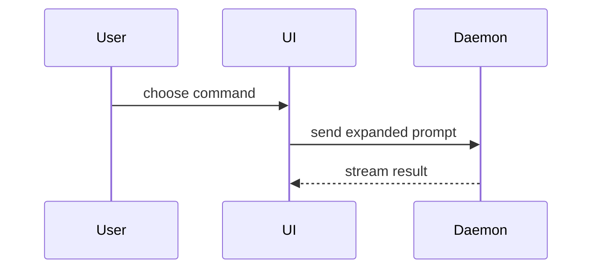

# Pull-request body template

The body is a one-minute briefing for a reviewer who has the diff, not a lab
notebook. It says why the change exists, what it leaves out, what it could
break, and how you proved it works. The body becomes the squash commit body,
so keep it under about 40 lines. End with the issue line from `6-link-issue`
of the Publish procedure when one applies.

Write for a reviewer without session context. Write short, simple sentences
with few identifiers and no walls of text. Use the project's domain terms and
apply the [unslop](../../unslop/SKILL.md) rules. Use
`##` headings, not bold lead-ins, in the order below. Drop a section that has
nothing to say, except Scope, which is always present.

- **Why:** the problem and the approach, in 1 to 3 short sentences. No SHAs,
  rebase history, or "based on main" preamble.
- **What changed:** 1 to 3 short bullets, the most important change first.
  Name a real symbol or path only when it carries the change. Name both sides
  of a rename or retarget. Add the smallest visual that makes the point when
  the diff is not small enough to read in order.
- **Scope:** 1 to 3 short items on what the PR covers and what it leaves out
  on purpose, such as a follow-up or a known gap. No symbols, paths, or
  file-by-file essay.
- **Tradeoffs:** only rejected alternatives a reviewer would otherwise ask
  about. Skip it when there was no real choice.
- **Blast Radius:** 1 or 2 sentences on who or what the merge touches and why
  that is safe or risky. When trunk is red, state the cost of leaving it red.
- **Verification:** 1 to 3 bullets, each a real run path and its outcome, as
  a before and after. For performance, give one primary number with its unit,
  `before -> after`, and link the run directory for the rest.

After the sections, attach screenshots or videos when they prove a claim.
Full SHAs, swarm lane recitals, file-by-file checklists, metric tables, and
"CLEAN" verdicts go in a linked artifact, not the body. The one exception is
the verification record below.

Keep the text self-contained. Beyond the closing `Fixes` line, public text
does not reveal tracker URLs, issue or plan content, or internal workflow
commentary.

````markdown
## Why

<the problem and the approach, 1 to 3 sentences>

## What changed

- <most important change first>

<optional real code excerpt, diagram, diff sketch, or tree, each with a one-line caption>

## Scope

- <what this covers; what it leaves out on purpose>

## Tradeoffs

- <rejected alternative and why it lost>

## Blast Radius

<who or what the merge touches; why that is safe or risky>

## Verification

- <run path>: before <observed>, after <observed>

Verification record (optional): <PASS | PASS+NOTES | FAIL>; head `<sha>`;
base `<sha>`; patch-id `<id>`.
````

## What changed

Pick the smallest view that makes the key point clear. Show real code when
the reviewer needs to see the code; use a sketch when the point is a shape that
spans many files. Give each visual a one-line caption that says what to notice.
Keep only the calls, files, props, states, and boundaries a reviewer needs.
Usually one visual is enough; several is fine when each makes a different point.

### Real code

Excerpt the load-bearing change from the actual diff: 5 to 20 lines, with the
path in the caption. Use a `diff` block for a small change inside existing
code. When the code is rewritten, show a before block and an after block with
the language tag, so both keep syntax highlighting:

**`src/save.ts`: save skips the write when content is unchanged.**

Before:

```ts
export function save(doc: Doc): Result {
  return write(doc.content);
}
```

After:

```ts
export function save(doc: Doc): Result {
  if (doc.content === cache.get(doc.id)) return cache.result(doc.id);
  return write(doc.content);
}
```

Copy a real-code excerpt from the diff exactly, so a reviewer can find it; an
edited excerpt belongs under Sketches, written as pseudocode. A permalink to a
line range at the pushed commit renders as a snippet in the same repository's
comments; in a pull-request body it may show as a plain link, so paste the
excerpt there.

### Sketches

Show logic or an algorithm as pseudocode:

```text
on(save)
  if content is unchanged
    return cached result
  write new content
  return fresh result
```

Show runtime control flow as a call tree:

```text
submitForm
  createSession
    persistPrompt
    launchAgent
  navigateToSession
```

Show UI structure as a component tree, with the state and module boundaries
that matter:

```text
<SessionPage> (apps/example/src/routes/session.tsx)
  useSessionEvents()
  <SessionToolbar>
    <RunSkillButton> (packages/ui)
```

Show file responsibility or a broad refactor as a shallow file tree:

```text
src/
├── commands/       # parses user actions
├── sessions/       # owns session state
└── transport/      # sends API requests
```

Show component interaction or data flow with Mermaid:



Use a `diff` block when the point is what changes and the surrounding shape
already exists. Match the diff to the shape of the topic, such as a call tree:

```diff
 submitForm
   createSession
     persistPrompt
+    expandSkillMention
     launchAgent
   navigateToSession
+    subscribeToEvents
```

Show the whole block instead when most of it is new, when omitted context
would hide ownership or order, or when the reviewer needs a copyable target
shape.

## Verification

Show concrete proof that each claimed behavior works, as a before and after.
Prefer a screenshot when the change is visual and the environment can capture
one. Otherwise show execution: the command a reviewer can paste with its
observed output, or the named test that failed before and passes after, with
its assertion sketched as pseudocode. When no reproducible demonstration
exists, say so and name what the reviewer should inspect instead.

Never list lint, type-check, build, or test-suite runs as evidence. Every PR
must pass them, so they prove nothing about this one. State known gaps and
pre-existing failures, and distinguish recorded prior results from checks run
in the current workspace.

When an independent verdict gates landing, add the verification record in the
template's form, and nothing else.
The Land procedure in [ship-pr](../SKILL.md) (`2-key-verdict-to-patch` and
`3-recheck-before-landing`) says how to compute it and when to recompute it.
Replace the record when it changes; keep one current record.

## Blast Radius

Name what the merge can affect. Consider every consumer: callers and
downstream packages, installed plugins and hooks, layout and mobile rendering,
stored data, and other agents or providers. Call out any effect a revert would
not undo, such as deleted data, a migration, or something already published.
