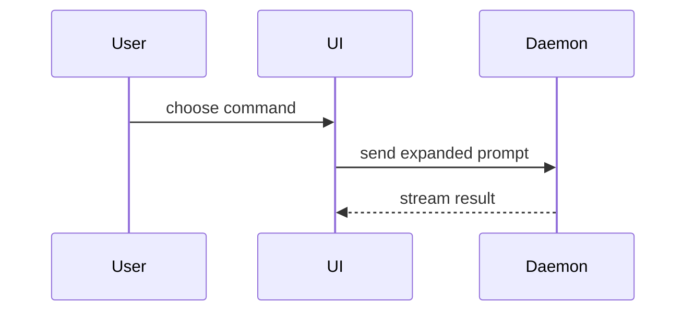

# Pull-request body template

A PR body describes the change as it will merge. The reader is a reviewer who
never saw the chat. Write it from the diff, the base branch, and the linked
issue, not from the conversation.

## How the body is built

The agent never writes the body or its headings. It writes one file per slot
of [templates/pr-body.md](../templates/pr-body.md), and the script fills the
template:

| Slot file | Content |
| --- | --- |
| `summary.md` | Motivation in one or two sentences, as a problem in the system, then the visual. See [Summary](#summary). |
| `evidence.md` | Before and after. See [Evidence](#evidence). |
| `reversible.md` | `yes`, or `no:` and what a revert leaves behind. See [Risk](#risk). |
| `blast_radius.md` | One word, then optional ramifications. See [Risk](#risk). |

```bash
python3 <ship-pr>/scripts/pr_body.py render <slot-folder> --link "Fixes ABC-123" -o body.md
gh pr create --draft --title "<title>" --body-file body.md
```

`<ship-pr>` is this skill's directory. `render` refuses a slot that is
missing or empty, holds a heading, or names the requester or the chat. A
swe `PreToolUse` hook runs the same check before every `gh pr create` and
`gh pr edit`. It blocks an inline `--body`, `--fill`, and any body file that
is not the filled template. In a repo with its own
`pull_request_template.md`, follow that template; the hook then checks
only for requester attribution. Fix the content; never work around the hook.

## Rules for slot content

1. Never name the requester, the user, or the chat. No "the user asked", "the
   user wants", "as requested", "per your request", or "in this session". A
   decision is a fact about the change.
2. Describe the net change only. Leave out abandoned attempts, the order of
   work, and the commands you ran.
3. Write from the diff, the base branch, and the linked issue, not from the
   conversation.

Bad `summary.md`:

> The user asked for a faster cache, as discussed in the chat.

Good `summary.md`:

> Each save rewrites the whole cache, so a large project takes 4 s to save.
> Write only the changed entries.

## Sections

Skip all preambles and keep prose brief. Use the project's domain terms.

### Summary

Pick the smallest view that makes the key point clear.

- Show logic or an algorithm as pseudocode:

```text
on(save)
  if content is unchanged
    return cached result
  write new content
  return fresh result
```

- Show runtime control flow as a call tree:

```text
submitForm
  createSession
    persistPrompt
    launchAgent
  navigateToSession
```

- Show UI structure as a component tree, including state and module boundaries that matter:

```text
<SessionPage> (apps/example/src/routes/session.tsx)
  useSessionEvents()
  <SessionToolbar>
    <RunSkillButton> (packages/ui)
```

- Show file responsibility or a broad refactor as a shallow file tree:

```text
src/
├── commands/       # parses user actions
├── sessions/       # owns session state
└── transport/      # sends API requests
```

- Show component interaction, control flow, or data flow with Mermaid:



- Use `diff` when the point is what changes and the surrounding shape already exists. Match the diff shape to the topic.

For a component change:

```diff
 <SessionPage>
   useSessionEvents()
   <SessionToolbar>
+    <RunSkillButton />
   <SessionTimeline>
+    <SkillResultCard />
```

For a file-layout change:

```diff
 src/
 ├── commands/
+│   └── show-me.ts       # expands the slash command
 ├── sessions/
-└── transport.ts
+└── transport/
+    ├── client.ts
+    └── stream.ts
```

For a call-tree or call-stack change:

```diff
 submitForm
   createSession
     persistPrompt
+    expandSkillMention
     launchAgent
-  navigateToSession
+  navigateToSession
+    subscribeToEvents
```

For a state or control-flow change:

```diff
 on(save)
-  write content
+  if content is unchanged
+    return cached result
+  write new content
+  invalidate cache
```

- Show the whole block when most of it is new, when omitted context would hide ownership or order, or when the user needs a copyable target shape:

```ts
function expandSkill(command: string): string {
  const skillName = command.slice(1);
  return `use the ${skillName} skill`;
}
```

#### Guidance

Place each visual next to the short text it supports. Keep only the calls, files, props, states, and boundaries needed to answer the user's current question or the options to resolve the current discussion point.

You may use one of these, you may use several, it is unlikely you will use all of them. Use your judgement and don't overwhelm the user.

### Evidence

Concrete evidence that the change works. Show a before and after.

Screenshots are S-tier - when the environment is set up for it and the change is visual.

Execution-based evidence is A-tier. Test results, console output. Show the exact test that now fails and passes, using pseudocode.

Lint, type-check, build, and full test-suite runs are not evidence: every PR must pass them. When an independent verdict gates landing, add one line under Evidence: `Verification record: <PASS | PASS+NOTES | FAIL>; head <sha>; base <sha>; patch-id <id>.` The Land procedure in [ship-pr](../SKILL.md) says how to compute it and when to replace it.

### Risk

Say whether a revert fully undoes the merge. Write `yes` when it does. Write `no` and name what stays after a revert: deleted data, a migration, a published release, a sent message, or a decision other work will build on. Name what protects those parts.

The blast radius is the potential impact or scope of the changes introduced by this PR. Consider all possibilities. Examples are layout shift, breakages for consumers, mobile responsiveness, etc.

## Closing line

Pass `--link "Fixes #123"` (or `--link "Part of #123"`) to `render` when the work has an issue. See `6-link-issue` in [ship-pr](../SKILL.md).
