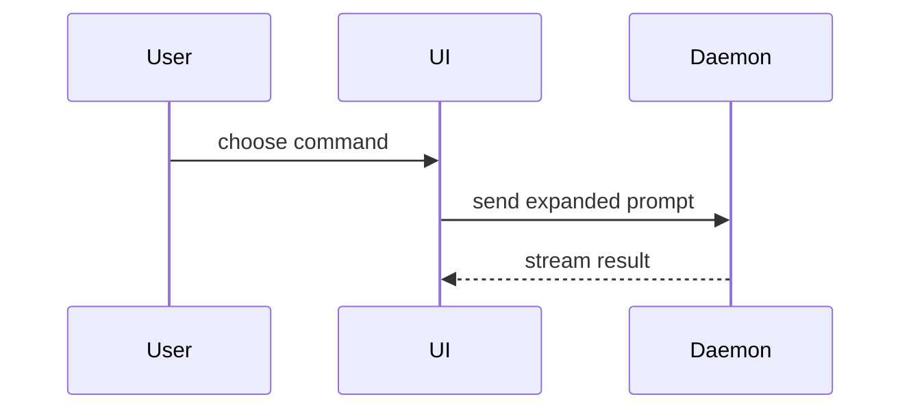

# Show me: visuals that explain code

Use one small visual to show a change or a design: in a PR body, a handoff, a
plan, or a reply that explains a design. Do not use it in docs pages (they
follow the Diataxis modes), in code comments, or in a short reply that needs no
picture.

Pick the smallest view that makes the key point clear. Show real code when
the reader needs to see the code; use a sketch when the point is a shape that
spans many files. Give each visual a one-line caption that says what to notice.
Keep only the calls, files, props, states, and boundaries a reader needs.
Usually one visual is enough; several is fine when each makes a different point.

## Real code

Excerpt the load-bearing change from the actual diff: 5 to 20 lines, with the
path in the caption. Use a `diff` block for a small change inside existing
code. When the code is rewritten, show a before block and an after block with
the language tag, so both keep syntax highlighting:

**`src/save.ts`: save skips the write when content is unchanged.**

Before:

```ts
export function save(doc: Doc): Result {
  return write(doc.content);
}
```

After:

```ts
export function save(doc: Doc): Result {
  if (doc.content === cache.get(doc.id)) return cache.result(doc.id);
  return write(doc.content);
}
```

Copy a real-code excerpt from the diff exactly, so a reader can find it; an
edited excerpt belongs under Sketches, written as pseudocode. A permalink to a
line range at the pushed commit renders as a snippet in the same repository's
comments; in a pull-request body it may show as a plain link, so paste the
excerpt there.

## Sketches

Show logic or an algorithm as pseudocode:

```text
on(save)
  if content is unchanged
    return cached result
  write new content
  return fresh result
```

Show runtime control flow as a call tree:

```text
submitForm
  createSession
    persistPrompt
    launchAgent
  navigateToSession
```

Show UI structure as a component tree, with the state and module boundaries
that matter:

```text
<SessionPage> (apps/example/src/routes/session.tsx)
  useSessionEvents()
  <SessionToolbar>
    <RunSkillButton> (packages/ui)
```

Show file responsibility or a broad refactor as a shallow file tree:

```text
src/
├── commands/       # parses user actions
├── sessions/       # owns session state
└── transport/      # sends API requests
```

Show component interaction or data flow with Mermaid:



Use a `diff` block when the point is what changes and the surrounding shape
already exists. Match the diff to the shape of the topic, such as a call tree:

```diff
 submitForm
   createSession
     persistPrompt
+    expandSkillMention
     launchAgent
   navigateToSession
+    subscribeToEvents
```

Show the whole block instead when most of it is new, when omitted context
would hide ownership or order, or when the reader needs a copyable target
shape.

## Merge danger

Say whether the change is a one-way door or a two-way door. A two-way door is
cheap to walk back: a revert undoes it. A one-way door is hard to reverse:
deleted data, a migration, a published release, or a decision other work will
build on. Name the one-way parts and what protects them.
